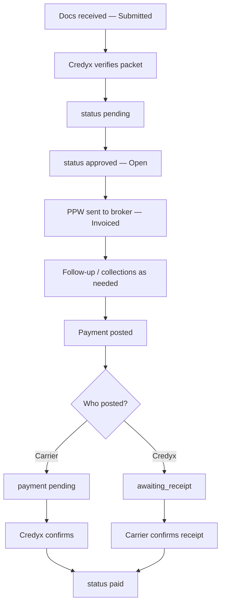

# Invoice lifecycle — all possibilities

This is the operational map of a Credyx invoice: stored status, what the UI shows, overlays (hold, dispute, Will Pay), money events, and how an invoice can close.

Credyx is **A/R + back office**, not factoring. We do **not** confirm delivery or capture POD in the field. The carrier-facing stepper is always:

**Submitted → Verified → Invoiced → Paid** (or Short paid / Confirm / Force closed / Written off on the last step).

Related specs: [write-off](features/01-write-off-approval.md), [payment posting](features/02-payment-posting.md), [force-close](features/03-force-close.md), [payment corrections](features/06-payment-corrections.md). Seed-audit notes: [INVOICE_LIFECYCLE_FIXES.md](INVOICE_LIFECYCLE_FIXES.md).

---

## 1. Two layers: stored vs displayed

### Stored invoice `status` (`Invoice.status`)

| Value | Meaning |
|---|---|
| `pending` | Packet in Credyx review (Pending review) |
| `approved` | Open A/R — paperwork good; may or may not have been invoiced to the broker |
| `hold` | Paperwork / claim hold (missing docs, etc.) |
| `rejected` | Failed verification |
| `paid` | Closed as paid (confirmed cash covers the invoice, or remaining is accepted) |
| `write_off_pending` | Carrier asked to write off; Credyx has not approved yet |
| `written_off` | Uncollectable; **fee-exempt** |
| `force_closed` | Aged-out close by Credyx (managed); **fee still billable** |

`approved` is **Open**, not “Approved” on lists.

### Display overlays (do not replace `status` unless noted)

These can sit on top of `approved` / `hold` / overdue open A/R:

| Overlay | Stored on | List / overview label |
|---|---|---|
| Open | `status === approved`, not disputed, not Will Pay | **Open** (blue) |
| Overdue | `approved` or `hold`, 15+ days past expected pay | **Overdue** (or Open + aging color) |
| Will Pay | `collection_status === 'W/P'` (+ date) | **Will Pay** (green) + **Scheduled pay** |
| Call Back | `collection_status === 'C/B'` | Collections callback; still open A/R |
| Open Disputed | Open invoice dispute or payment-receipt dispute | **Open Disputed** |
| On hold | `status === hold` | **On hold** |
| Pending payment | Client-posted payment `pending` | Queue: Pending payments |
| Awaiting confirmation | Credyx-posted, carrier must confirm | **Confirm** / Awaiting confirmation |
| Receipt dispute | Payment `disputed` | Receipt disputes queue |
| Write-off queue | `write_off_pending` | Write-offs |
| Paid | `paid` | **Paid** (green); age frozen invoice→pay date |
| Force closed / written off | those statuses | Closed; age frozen |

Admin Invoices chips are **on/off display buckets** (one bucket per invoice). Search ignores chips. Paid chip is **off by default**.

---

## 2. Happy path (no exceptions)



| Step | Label | What Credyx does |
|---|---|---|
| 01 | Docs received | Carrier submits packet / invoice to Credyx |
| 02 | Paperwork verified | Verify documents so nothing is missed |
| 03 | Invoice submitted | Send PPW to broker; track acceptance |
| 04 | Broker follow-up | Chase, holds/disputes, keep carrier informed |
| 05 | Payment received | Confirm payment when it arrives — **on time**, not “faster” |

Until `paid` / closed, the invoice stays in **open A/R** (`approved` or `hold`).

---

## 3. Verification branches

```
pending
  ├─ approve ──────────► approved (Open)
  ├─ hold ─────────────► hold (On hold) ──► resolve docs ──► approved
  └─ reject ───────────► rejected (terminal for this packet)
```

- **Hold before PPW:** stepper stays on **Verified** (red).
- **Hold after PPW:** stepper stays on **Invoiced** (red) — it does not roll back.
- Receipt-dispute “hold” is **not** a paperwork hold; treat as open A/R / Open Disputed.

---

## 4. Open A/R possibilities (still `approved` or `hold`)

Any of these can combine except where noted.

### 4.1 Aging / overdue

- Age = days from **invoice date** (open) or **invoice date → pay/close date** (paid/closed).
- Overdue = open A/R **15+ days** past expected pay (`AR_POLICY.collectionsOverdueDays`).
- Hold can still be overdue for aging; status stays **On hold**.
- Urgent / critical / force-close eligible: 25 / 60 / **90** days outstanding (managed force-close only).

### 4.2 Will Pay (`W/P`)

Credyx posts **Will Pay** + a **scheduled payment date** (`collection_date`).

- List/overview: **Will Pay**, field **Scheduled pay**.
- Stored status stays **open A/R** (`approved` unless also on hold).
- **Same day the date passes:** nothing automatic.
- **Default 5 days after** scheduled date, still unpaid → Collections **urgent** (`will_pay_missed` / “Will Pay unpaid 5d+”).
- Does **not** go to carrier **Attention** (that list is paperwork holds only).
- Chase “needs attention” is a **separate** clock (no broker reply after inquiry).

Settings: `COLLECTIONS_POLICY.willPayMissedDays` (default 5), `willPayUrgent`.

### 4.3 Call Back (`C/B`)

Scheduled broker call. On/after that date → Collections **Call back due**. Still open A/R.

### 4.4 Paperwork / invoice dispute

Carrier (or Credyx) opens an invoice dispute (`disputes[]` open / under review).

- Display: **Open Disputed** (not “Invoiced”).
- Under review stays Open Disputed until resolved.
- Stepper: stay on **Invoiced** if PPW already sent.

### 4.5 Payment queues (money in flight, invoice often still `approved`)

| Queue | Payment `status` | Invoice display |
|---|---|---|
| Pending payments | `pending` (carrier posted, Credyx not confirmed) | Pending payments chip |
| Awaiting confirmation | `awaiting_receipt` | Confirm / awaiting confirmation |
| Receipt dispute | `disputed` | Open Disputed + receipt-dispute queue |
| Write-off queue | invoice `write_off_pending` | Write-offs |

---

## 5. Payment possibilities

Payment `status`: `pending` → `awaiting_receipt` | `confirmed` | `rejected` | `disputed` | `reversed`.

`payment_kind`: `normal` | `short` | `over`.

```
Posted funds
  ├─ Full (within epsilon) ──► invoice paid
  ├─ Short ────────────────────► still open A/R, Short paid
  │     ├─ remaining paid later
  │     ├─ write-off remaining
  │     └─ chargeback (kind short) can reopen a paid invoice
  └─ Over ─────────────────────► paid + overage; carrier may Accept overpayment
```

**Who posts**

| Actor | Typical payment status | Invoice until confirmed |
|---|---|---|
| Carrier | `pending` | No paid/short until Credyx confirms |
| Credyx | `awaiting_receipt` | Carrier Confirm (yellow Paid step); auto-confirm after deadline if unused |
| Credyx confirm of pending | `confirmed` | Apply full / short / over |
| Reject | `rejected` | Invoice unchanged |
| Receipt dispute | `disputed` | Re-queue or reject after Credyx response |
| Move funds / unprocess | original `reversed`; optional new confirmed on another invoice | Source reopens if that was the covering cash |

**Confirm payment** is the carrier action that funds were received — not a Credyx “delivery” step.

---

## 6. Close paths (terminal or quasi-terminal)

```
open A/R
  ├─ full confirmed pay ──────────────► paid
  ├─ overpay accepted ───────────────► paid (overage acknowledged)
  ├─ short remaining + write-off
  │     └─ client request ────────────► write_off_pending
  │           ├─ Credyx approve ──────► written_off (fee-exempt)
  │           └─ Credyx deny ─────────► back to open A/R
  ├─ 90d+ managed force-close ───────► force_closed (fee billable)
  └─ rejected at verify ─────────────► rejected
```

| Close | Fee | Aging | Can still post corrections? |
|---|---|---|---|
| `paid` | Normal A/R fee rules | Frozen at pay date | Yes (short/over/move) |
| `written_off` | Exempt | Frozen / closed | Admin postable for corrections |
| `write_off_pending` | Still billable | Not open A/R chase | Blocked until decision |
| `force_closed` | Billable | Frozen / closed | Admin postable |
| `rejected` | Exempt | Closed | No |

Self-service: **no** force-close. Managed: force-close at 90+ days outstanding when enabled.

---

## 7. Collections & email (while open)

### Collections chase (after PPW)

Relative to **paperwork confirm days** (broker override, default **7**) then **Net terms**:

| Track | Meaning |
|---|---|
| `no_ppw` | Open invoice, packet never sent — **major issue**, urgent collection |
| `ppw_waiting` | PPW sent; waiting until the broker’s confirm window |
| `ppw_check` | Window elapsed — confirm the broker received paperwork (**broker confirmed**) |
| `payment_waiting` | Paperwork confirmed; waiting until Net / due date |
| `payment_verify` | Net terms reached — call the broker for payment status |
| `past_due_urgent` | X days (Settings) past Net with no pay — **urgent collection** (distinct queue styling) |

Chase follow-up if they go quiet after an inquiry:

| Chase status | Meaning |
|---|---|
| `not_due` | Too soon to inquire |
| `due_for_inquiry` / `ppw_check_due` / `payment_verify` | Ask is due |
| `awaiting_response` | Inquiry sent, waiting |
| `due_for_followup` | ~3 days, no reply |
| `needs_attention` | ~5 days no reply **or** `collections_needs_attention` — Credyx should call |
| `past_due_urgent` | Urgent collection queue |

Urgent flags (can stack): missed Will Pay, missed callback, risky broker, past due, **PPW not sent on open invoices**, stale contact, needs call.

Broker **Paperwork confirm (days after PPW)** defaults to 7; set 10–15 per broker if they are slow to reply. Payment verify starts at **Net terms**, not a fixed day after PPW (unless the broker has no due date).

### Email lifecycle tracks

Paperwork track (after PPW): first inquiry → second follow-up → staff needs-attention.

Payment track: only after paperwork status is logged good → payment inquiry → follow-up → staff needs-attention.

Carrier notices: batch processed, hold/claim, dispute opened. Not a substitute for invoice `status`.

---

## 8. Admin Invoices display buckets (exclusive)

Priority (first match wins):

1. Write-off queue  
2. Receipt dispute  
3. Pending payment  
4. Awaiting confirmation  
5. Pending review (`pending`)  
6. On hold  
7. Overdue  
8. Open (`approved`)  
9. Paid (opt-in chip)  
10. Other (force closed, written off, etc.) — only if all work chips are on  

Turning **Open** off does not hide overdue or Will Pay.

---

## 9. Carrier vs Credyx — who sees what

| Surface | Typical labels |
|---|---|
| Carrier invoices | Open, Open Disputed, On hold, Overdue, Confirm payment, Short paid, Paid, Written off (masks `write_off_pending`) |
| Carrier Attention | Paperwork holds that need upload — **not** missed Will Pay |
| Carrier Collections | Performance: needs attention, past due, payment promised, Credyx working, … |
| Admin Invoices | Same plus queues, Will Pay, Write-offs, Force closed |
| Admin Collections | Chase + Will Pay + Urgent + callbacks |

---

## 10. Quick “what can this invoice be?” checklist

An invoice is always **exactly one** stored `status`, plus zero or more overlays:

- [ ] Pending review  
- [ ] Open (approved, not overdue overlay)  
- [ ] Overdue open A/R  
- [ ] On hold (before or after PPW)  
- [ ] Will Pay + scheduled date  
- [ ] Call Back + date  
- [ ] Open Disputed (invoice and/or remittance)  
- [ ] Pending payment / awaiting confirm / receipt dispute  
- [ ] Short paid (open remainder)  
- [ ] Confirm (awaiting carrier receipt)  
- [ ] Paid (full) / Paid + over  
- [ ] Write-off pending / written off  
- [ ] Force closed  
- [ ] Rejected  

Not in this product: factoring, advances, “get paid faster,” or Credyx confirming load delivery.
